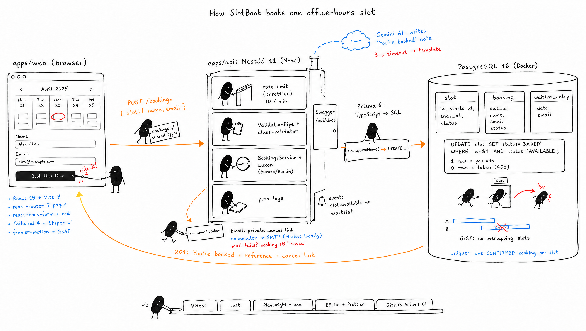

# SlotBook

Book office hours: short one-to-one sessions with a single host. The host publishes time slots, and
visitors pick one, book it in under a minute and get a private link to cancel.



## How to run it

You need Node 20 or newer and Docker Desktop.

```bash
cp .env.example .env          # then set HOST_ACCESS_KEY to a long random value
docker compose up -d          # Postgres 16, plus Mailpit to catch emails locally
npm install
npx prisma migrate dev        # creates the tables and database rules
npm run seed                  # optional: two weeks of sample slots
npm run dev                   # API on :3000, web app on :5173
```

| Open | For |
|---|---|
| http://localhost:5173 | The booking site |
| http://localhost:5173/host | Host dashboard (asks for `HOST_ACCESS_KEY`) |
| http://localhost:8025 | Mailpit inbox with the confirmation emails |
| http://localhost:3000/api/docs | API docs (Swagger) |

Tests: `npm test` (unit, integration and web), `npm run test:e2e` (Playwright with axe accessibility
checks), and `npm run lint`.

Optional settings in `.env`: `GEMINI_API_KEY` for AI-written confirmation messages, and `SMTP_URL`
to send real email instead of using Mailpit.

## What I built

- **Weekly calendar** of open slots, with the week in the URL, seven columns on desktop and a day
  list on phones.
- **Booking** with name and email, a reference like `K7M2-QX9P`, and a confirmation page.
- **No double bookings, even under a race.** PostgreSQL enforces it itself: a guarded `UPDATE` lets
  only one request win, a partial unique index allows one confirmed booking per slot, and a GiST
  exclusion constraint stops slots from overlapping. One test fires 20 bookings at the same slot at
  once, and exactly one succeeds.
- **Cancelling** through a private link, which is shown once on screen and emailed. It works until
  an hour before the start. Only a hash of the link's token is stored.
- **Waitlist** for fully booked days. When a booking is cancelled, people on the waitlist see that
  a slot has opened up.
- **Host dashboard**: stats, upcoming bookings, adding and deleting slots, and insights (a heatmap
  of bookings by weekday and hour, the top 3 times, and the booking rate per weekday).
- **AI confirmation message** from Gemini, with a 3-second timeout and a template fallback.
- **Quality**: rate limiting, Swagger docs, structured logs, WCAG 2.1 AA checks on every page, and
  layouts tested at desktop, Pixel 7 and iPhone SE sizes. GitHub Actions runs lint, about 400
  unit and integration tests, and the end-to-end suite.

**Stack:** React 19, Vite 7, react-router 7, react-hook-form with zod, Tailwind 4, Skiper UI,
framer-motion, GSAP · NestJS 11, Prisma 6, Luxon, nodemailer · PostgreSQL 16 in Docker ·
Vitest, Jest, Playwright · one npm-workspaces monorepo in TypeScript.

The full technical notes, with the requirement status, API examples and design decisions, are in
[docs/DETAILS.md](docs/DETAILS.md). The requirements are in [SRS.md](SRS.md) and the design system
is in [DESIGN.md](DESIGN.md).

## AI tools I used

- **Claude Code (Claude Opus)** built the app from the requirements in `SRS.md`, one feature at a
  time: code, tests, database rules, debugging, design fixes and this README. I reviewed each step,
  ran the app, and asked for changes.
- **Higgsfield (GPT Image 2.5)** for the illustration above, made with the ian-xiaohei-illustrations
  skill and then edited to add the email step.
- **Gemini (gemini-3.5-flash-lite)** inside the app, writing the personal confirmation message.

## What I would improve with more time

- **A real email provider** with its own sending domain, so emails don't land in spam.
- **Email the waitlist** when a slot opens, instead of only showing it on the waitlist's status page.
- **Calendar invites**: attach an `.ics` file to the confirmation email, and allow rescheduling, not
  just cancelling.
- **Proper host accounts** with sign-in instead of one shared access key, and support for more than
  one host.
- **Show times in the visitor's own time zone** as well as the host's.
- **A manual accessibility pass** with a keyboard and a screen reader, plus screenshot comparison
  tests, on top of the automated axe checks.
